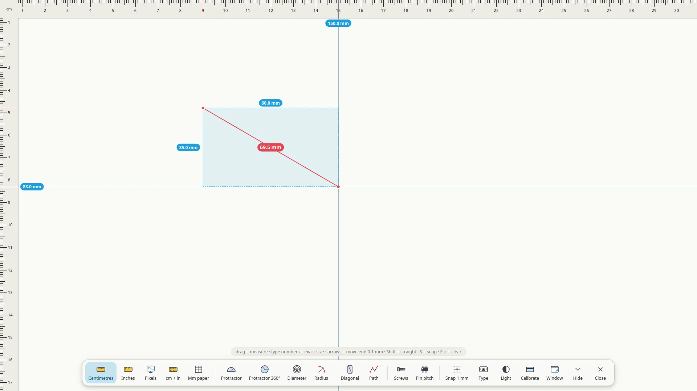

# Regula

**A ruler that's actually to scale.** Regula turns your screen into real-size measuring tools — rulers,
protractors, a screen-diagonal meter, screw and pin-pitch gauges. Lay something on the display and read
its size in real millimetres.

**Website and downloads: [regula.is-my.app](https://regula.is-my.app)** — Linux, macOS and Windows, free.



## How it knows the real size

Every monitor reports its physical size (EDID). A 14″ ThinkPad says 309 mm; 1920 px across 309 mm is
6.21 px per mm, and every tick, circle and protractor is drawn with that number. For a perfect scale,
hold any bank or ID card (85.60 mm wide) to the screen and match the outline — once per monitor.
With two monitors, each one keeps its own scale, and measurements stay in millimetres when you move the window.

## 13 tools

- **Rulers:** centimetres, inches (1/16″), pixels, cm + inches, millimetre paper
- **Angles & circles:** protractor 180° and 360°, diameter rings, radius from 3 points
- **Measure:** screen diagonal (lay a phone on the screen), path length & area
- **Workshop:** metric screws M1.6–M8, pin pitch combs (2.54 – 0.5 mm, JST, SOIC, FFC…)

Type numbers for an exact size (`20` Enter `50` Enter), nudge points by 0.1 mm with the arrow keys,
snap to 0.5 / 1 / 5 mm, and pick a light, dark, cutting-mat green or transparent background.
No account, no telemetry, no network access.

## What's in this repository

| Path | What | Built with |
|---|---|---|
| `regula.py`, `regula.svg` | Linux app (one Python file) | Python 3.9+ and PySide6 |
| `macos/` | Native macOS app | Swift, AppKit + Core Graphics — `./build.sh` on a Mac with the Command Line Tools |
| `windows/` | Native Windows 10/11 app | C#, Windows Forms on .NET Framework 4.8 — `./build.sh` with the .NET SDK (builds on Linux too) |
| `web/` | The website | Static HTML/CSS, no build step |
| `tools/` | Screenshot and video generators for the website | PySide6 |

All three apps share the same tools, layout and keyboard shortcuts. The interface is in English and Slovak;
code comments are in Slovak.

Run the Linux version:

```sh
python3 -m venv ~/.venvs/regula
~/.venvs/regula/bin/pip install PySide6
~/.venvs/regula/bin/python regula.py
```

## Bugs and ideas

Found a bug or a wrong measurement? [Open a bug report](https://github.com/Dany161024/Regula/issues/new?template=bug_report.yml)
— the form asks for your platform and display, which is usually what matters. Ideas for new tools are welcome too.

## License

Regula is free software under the [GNU General Public License v3.0](LICENSE).
Made by [Dany161024](https://github.com/Dany161024).
